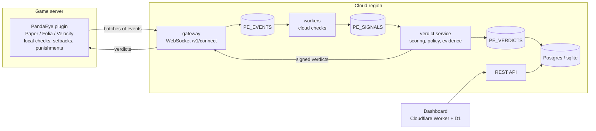

# PandaEye

PandaEye is a cloud anticheat for Minecraft Java servers (Paper, Folia and their forks, 1.21.4+, and
Velocity). **Server owners: start with [docs/INSTALL.md](docs/INSTALL.md).** A lightweight
plugin captures packets and runs the checks that must act within the tick (movement, timer, invalid
protocol); the cloud runs the heavy heuristics (combat, aim, reach, clicks, scaffold, inventory, latency
abuse), scores players and sends verdicts back: suspicion leads to mitigations, certainty to bans. Every
kick and ban carries evidence (checks, confidence, a replay clip) and can be appealed and reviewed in a
web dashboard.

Design points:

- **Safe to install on a live server**: the plugin starts in shadow mode, in which it never sends,
  cancels or modifies a packet and never punishes; it can be hot-loaded and unloaded.
- **Degraded mode**: if the cloud is unreachable, local checks keep running and events are buffered and
  judged on reconnect.
- **Pure JVM plugin** (no native libraries; ARM works); detection logic of the cloud checks never ships in
  the jar.
- **Multi-tenant SaaS**: per-tenant isolation, per-peak-player metering, a free tier, a public API,
  Discord alerts, an opt-in reputation network, a published latency SLO with a public status page.

## Architecture



The plugin streams events over one WebSocket; the gateway stores them in a NATS JetStream stream
partitioned by player; workers run the cloud checks and emit signals; the verdict service scores players
and decides actions; verdicts go back through the gateway to the plugin, which acknowledges them. A probe
travels the same path every 10 seconds to measure the latency the SLO is about. Details:
[docs/ARCHITECTURE.md](docs/ARCHITECTURE.md).

## Repository layout

```
proto/pandaeye/v1/   wire.proto (plugin <-> cloud), stream.proto (internal bus)
plugin/              Gradle multi-project, Java 21: protocol, common, paper (Paper + Folia), velocity
cloud/               Go module: one binary `pandaeye` with subcommands all, gateway, worker, verdict, api,
                     migrate, replay, version
dashboard/           Cloudflare Worker (TypeScript, Hono) + D1 migrations
ml/                  Python training pipeline: features, training, ONNX export, evaluation gate
deploy/              Dockerfile, docker-compose, NATS configs and auth generator, ClickHouse schema,
                     systemd units, Pterodactyl notes
test/e2e/            end-to-end harness: real Paper/Folia servers, bots and cheat scenarios
test/fixtures/       cross-language codec fixtures
docs/                specification and operations documents (below)
```

## Quick start (local, shadow mode)

Prerequisites: Go 1.26, Java 21, Gradle 8.14, a Paper or Folia 1.21.4+ test server with the PacketEvents
2.13.x plugin installed.

1. **Run the cloud** as a single process (embedded NATS, sqlite under `./data`):

   ```sh
   cd cloud
   go build -o bin/pandaeye ./cmd/pandaeye
   PE_STATIC_LICENSES='<dev-licence-key>:5' ./bin/pandaeye all
   ```

   The gateway listens on `:8080` (`/v1/connect`, `/healthz`, `/status`) and the API on `:8081`.
   `<dev-licence-key>` is any key that passes the licence-key format check of the build;
   `:5` allows five servers. In `all` mode the outbound key and the licence pepper are generated and stored
   in the database.

2. **Build the plugin**:

   ```sh
   cd plugin
   gradle build        # or ./gradlew build once the wrapper is committed
   ```

   The Paper/Folia jar is `plugin/paper/build/libs/PandaEye-<version>.jar`; the Velocity jar is under
   `plugin/velocity/build/libs/`.

3. **Install in shadow mode**: copy the jar to the server's `plugins/` folder next to PacketEvents and
   create `plugins/PandaEye/config.yml` (defaults in [ARCHITECTURE 4.11](docs/ARCHITECTURE.md)) with:

   ```yaml
   mode: shadow
   server-name: "test"
   cloud:
     endpoint: "ws://127.0.0.1:8080/v1/connect"   # ws:// is accepted for loopback only
     license-key: "<dev-licence-key>"
   ```

   Start the server (or hot-load with PlugManX: `plugman load PandaEye`) and run `/pandaeye status`: mode
   `shadow`, cloud connected, probe RTT reported. Shadow mode observes only; nothing is enforced until both
   the local `mode: live` and the dashboard's enforcement switch are on.

4. **Optional**: the dashboard (`dashboard/`, `npm run dev` with Wrangler), the split-service stack
   (`make -C deploy env certs nats-auth image up`), and the production rollout procedure in
   [docs/OPERATIONS.md](docs/OPERATIONS.md) section 8.7.

## Documentation

| Document | Contents |
|---|---|
| [docs/INSTALL.md](docs/INSTALL.md) | for server owners: requirements, install, dashboard, going live, updates |
| [docs/ARCHITECTURE.md](docs/ARCHITECTURE.md) | the implementation contract: components, protocol summary, data stores, API, security |
| [docs/CHECKS.md](docs/CHECKS.md) | every detection check: algorithm, thresholds, scoring |
| [docs/PROTOCOL.md](docs/PROTOCOL.md) | wire protocol guide: framing, handshake, batches, verdicts, errors, versioning, internal bus |
| [docs/OPERATIONS.md](docs/OPERATIONS.md) | deployment topologies, configuration reference, NATS permissions, TLS, runbooks, monitoring |
| [docs/SLO.md](docs/SLO.md) | published SLOs, how they are measured, release gates |
| [docs/DETECTION_MATRIX.md](docs/DETECTION_MATRIX.md) | cheat modules mapped to checks, known gaps, e2e scenarios |
| [docs/PRIVACY.md](docs/PRIVACY.md) | privacy notice, data processing description, template notice for server rules |
| [deploy/pterodactyl.md](deploy/pterodactyl.md) | running `pandaeye all` on Pterodactyl |
| [ml/FEATURES.md](ml/FEATURES.md) | ML feature vector contract |
