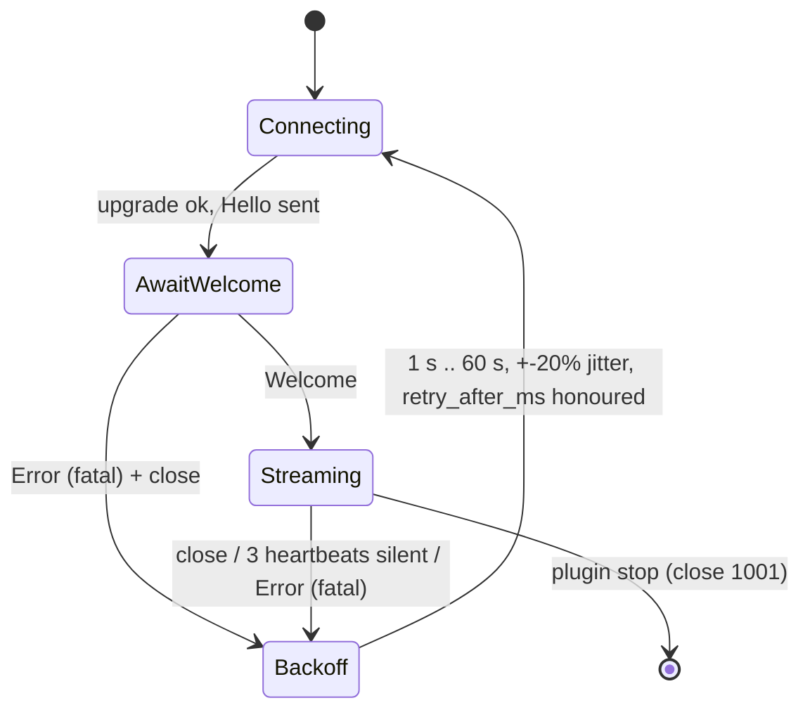
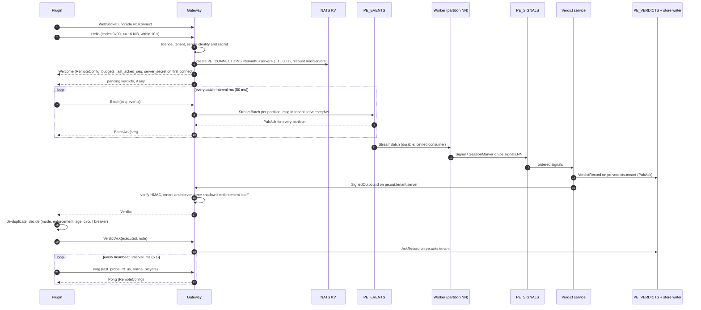

# PandaEye protocol guide (v1)

How a PandaEye plugin (Paper/Folia backend or Velocity proxy) talks to the cloud gateway, and how the
cloud components talk to each other over NATS. The authoritative definitions are
[`wire.proto`](../proto/pandaeye/v1/wire.proto), [`stream.proto`](../proto/pandaeye/v1/stream.proto) and
[ARCHITECTURE](ARCHITECTURE.md) sections 3, 5.3 and 5.4; this guide explains them. If this guide and the
proto files disagree, the proto files win. Behaviour the spec does not fix is marked **Open**; the
collected list is in section 15.

## 1. Transport and framing

- One WebSocket per server process at `wss://<host>/v1/connect`. Plugins refuse `ws://` except to a
  loopback address, or to a same-host or private-network address when `cloud.allow-insecure: true` is set
  (with a warning at enable). Only binary messages are used.
- Every message starts with a one-byte codec header:

| Byte 0 | Payload after the header | Used by |
|---|---|---|
| `0x00` | raw protobuf message | every Hello; the cloud for every ServerFrame in v1; plugins for frames <= 1 KiB raw |
| `0x01` | one zstd frame with `Frame_Content_Size` set | plugins for frames > 1 KiB raw |
| `0x02` | raw DEFLATE stream (RFC 1951, `Deflater(nowrap=true)`) | plugins whose zstd codec failed to initialise or threw (permanent fallback, logged once) |

- Plugin to cloud messages are `ClientFrame`, cloud to plugin messages are `ServerFrame`. Plugins must
  accept all three codecs on receive even though the v1 cloud never compresses.
- UUIDs are 16 raw bytes, big-endian, in `bytes` fields (`Event.player`, `Attack.target_player`, ...) and
  canonical lowercase strings (`8-4-4-4-12`) in `string` fields (`server_id`, `session`, `verdict_id`).

### 1.1 Limits

| Limit | Value | Enforced by |
|---|---|---|
| Compressed message (after the codec byte) | <= 1 MiB (gateway WebSocket read limit 1 MiB + 1) | gateway, plugin (parts accumulated up to 1 MiB) |
| Decompressed message | <= 8 MiB; zstd: single frame, content size present and <= 8 MiB, checked before allocating | both sides |
| Hello | codec `0x00`, <= 16 KiB, first frame, within 10 s of the upgrade | gateway |
| Batch | <= `Welcome.max_batch_events` events (default 4096) and <= 512 KiB raw (plugin) | plugin; gateway counts events with a protowire pre-scan before unmarshalling |
| One event | <= 64 KiB | gateway pre-scan |
| Strings | <= 256 bytes, `LocalFlag.info` <= 512 bytes; invalid UTF-8 replaced with U+FFFD | gateway |
| Repeated fields | `target_history` <= 64, `LocalFlag.data` <= 32, `StateChange.effects` <= 32, `Hello.capabilities` <= 32, `LocalFlag.context` <= 40 | gateway |
| Decompression in flight | <= 256 MiB of decompressed bytes across all connections (global semaphore) | gateway |

The spec lists the field limits without saying whether an over-limit field is truncated or the batch
rejected. The current gateway (`cloud/internal/codec`) truncates over-long strings at a UTF-8 boundary and
treats over-long repeated fields and UUID `bytes` fields that are neither empty nor 16 bytes as a poison
batch (section 3.2).

## 2. Connection lifecycle

While not `Streaming` the plugin is in degraded mode: local checks keep running and batches accumulate
in its pending buffer (section 3.3).

### 2.1 Hello

| Field | Rules |
|---|---|
| `protocol_version` | `1`. Anything else: `CODE_UNSUPPORTED_PROTOCOL` |
| `license_key` | verified (5.9); see 2.4 for failure handling |
| `server_id` | canonical lowercase UUID generated on first start and kept in `plugins/PandaEye/server-id`; never reused across installs (the current gateway also rejects the nil UUID) |
| `server_secret` | empty on the first connect of a `server_id`, afterwards the secret from the first Welcome |
| `instance_id` | random UUID per plugin process start; detects cloned plugin folders |
| `server_name`, `network_id` | shown in the dashboard; backends and the proxy of one network share `network_id` |
| `platform`, `platform_version`, `plugin_version`, `minecraft_version` | informational, stored on the server row |
| `shadow_mode` | the plugin's local lock (`mode: shadow`); copied into `Origin.shadow_mode`, which makes every verdict from this connection `shadow = true` |
| `capabilities` | optional features, e.g. `tick_end`, `env_sampling`, `target_history`, `probe`. **Open:** the spec does not define what the cloud does with them |
| `online_players`, `client_time_unix_ms` | metering and diagnostics |

### 2.2 Server identity and secrets

- A server is `(tenant_id, server_id)`; the tenant comes from the licence. The same `server_id` under
  another tenant is a different server.
- The first Welcome for a new `server_id` carries `server_secret`. The plugin stores it in
  `plugins/PandaEye/server-secret` (mode 0600) and presents it in every later Hello. The cloud stores only
  its hash (the current implementation: SHA-256).
- A Hello for a known `server_id` with a wrong or missing secret is rejected with `CODE_DUPLICATE_SERVER`.
  A server that lost its secret file must start as a new server (delete `server-id` and `server-secret`).
  **Open:** there is no API to reset a server's secret.

### 2.3 Duplicate detection

| Situation | Result |
|---|---|
| Unknown `server_id` | registered; Welcome carries `server_secret` |
| Known `server_id`, correct secret, no live connection | accepted |
| Known `server_id`, correct secret, live connection with the same `instance_id` (reconnect after a network break) | accepted; the new connection replaces the old one (the old gateway sees a revision mismatch on its `PE_CONNECTIONS` key and closes, or is told with `Outbound.close_connection_id`) |
| Known `server_id`, correct secret, live connection with a different `instance_id` that sent a frame in the last 15 s | `CODE_DUPLICATE_SERVER` (cloned plugin folder). The plugin waits 30 s and logs how to regenerate `server-id` |
| As above, but the existing connection has been silent for 15 s | accepted, the old connection is replaced |
| Known `server_id`, wrong or missing secret | `CODE_DUPLICATE_SERVER` |

### 2.4 Admission control

- Licence: verified by the configured verifier (`static` or `pandascript`), cached (valid 10 min, invalid
  1 min). If the verifier is unreachable the last successful verification persisted on the tenant row is
  used for up to 24 h; otherwise the answer is `CODE_INTERNAL` with `retry_after_ms = 30000`, never
  `CODE_UNAUTHENTICATED`. Licence failures are limited per IPv4 /32 and IPv6 /64: 5 per 10 min, then a
  1 h block.
- Server count: `maxServers` of the licence is enforced by creating the `PE_CONNECTIONS` key and
  recounting; over the limit the gateway deletes its own key and answers `CODE_LICENSE_LIMIT`.
- Connection rate: 30 new connections per minute per client IP and 60 Hellos per minute per tenant.
  Reconnects that present a valid server secret are exempt. Over the limit: `CODE_RATE_LIMITED`.

### 2.5 Welcome

| Field | Meaning |
|---|---|
| `connection_id` | unique per WebSocket; appears in `Origin` and in `PE_CONNECTIONS` |
| `tenant_id` | the licence's tenant |
| `server_time_unix_ms` | cloud clock, diagnostics |
| `config` | current `RemoteConfig` (leniency, autoban, autokick, mitigations, reputation_on_join, enforcement) |
| `heartbeat_interval_ms` | Ping interval, default 5000 |
| `max_batch_events` | default 4096 |
| `last_acked_seq` | highest batch seq the cloud holds for this server (0 = none); the plugin drops pending batches with `seq <=` it |
| `server_secret` | only when the server was registered by this Hello |
| `max_events_per_s`, `max_bytes_per_s` | live budget of this connection |
| `replay_max_events_per_s` | replay budget; the plugin paces resends to at most 50% of it |

The plugin persists `RemoteConfig` with a timestamp (`remote-config.properties`). Enforcement requires
local `mode: live` AND the last-known `enforcement = true` (false until a Welcome has ever said otherwise)
AND the feature's own switch. After Welcome the gateway subscribes `pe.out.<tenant>.<server>` and delivers
pending verdicts (section 7.3).

## 3. Batches

### 3.1 Sequence numbers

- `Batch.seq` starts at 1, increases by 1 per batch, is assigned when a batch is first sent and is never
  reused within a `server_id`. `BatchAck{seq}` means every batch with a seq up to that value is durable.
- Persistence across restarts: ARCHITECTURE 3 reserves seqs in blocks of 100 000 persisted in
  `state.properties`, so a restart resumes above anything used; the comment in `wire.proto` instead
  persists the next seq on shutdown and adds 1 000 000 on an unclean start. Both keep seqs monotonic;
  **Open:** the two descriptions disagree and should be reconciled (section 15).
- `sent_unix_ms` is the plugin's send time; it feeds the clock-offset estimate (section 6) and replay
  detection.

### 3.2 Gateway handling of one batch

1. Decode and validate (section 1.1). A batch that is too large or invalid is a poison batch:
   `Error{CODE_TOO_LARGE, fatal = false}`, then `BatchAck{seq}`, then drop, and a counter
   (`pandaeye_gateway_batches_total{result="too_large"|"invalid"}`). This is the only case where the
   gateway acknowledges data it did not store.
2. Split the events by partition, keeping their order: player events by
   `siphash24(partition_key, player uuid) % PE_PARTITIONS`; server-level events (empty `player`) by the
   same hash of the `server_id` bytes; probes by `probe_id % PE_PARTITIONS` (section 9).
3. Publish one `StreamBatch` per non-empty partition to `pe.events.<NN>` with msg id
   `<tenant_id>:<server_id>:<seq>:<NN>` and wait for every PubAck.
4. Send `BatchAck{seq}` and raise the server's last acked seq (KV `PE_SERVERS`, monotonic, plus an
   asynchronous database write).

A publish timeout keeps the connection: the gateway stops reading, retries with the same msg ids and
closes with `CODE_INTERNAL` only after 60 s.

### 3.3 Buffering, replay and pacing

- The plugin keeps every unacknowledged batch in its pending buffer (<= `max-buffer-mb`, 64 MiB, and
  <= `max-buffer-age-minutes`, 10; overflow drops the oldest and counts it). On plugin stop, unacked
  batches and undrained events are spooled to `plugins/PandaEye/spool/` (<= 64 MiB) and resent after the
  next enable; spool files older than 1 h are discarded.
- Resent batches carry `replayed = true`. The gateway also treats a batch as replayed when its normalised
  send time (`sent_unix_ms * 1000 + clock_offset_us`) is more than 30 s old.
- After a reconnect the plugin sends live batches first and paces replayed batches to <= 50% of
  `replay_max_events_per_s`.
- Downstream, replayed data is judged like live data, but stale data cannot punish: the verdict service
  never issues MITIGATE, KICK or BAN from signals whose `gateway_recv_unix_us` is more than 2 min older
  than the cloud clock (re-consumption) or whose normalised event time is older than 10 min (catch-up after
  a long outage); those produce ALERT at most.

### 3.4 De-duplication

| Layer | Key | Lifetime |
|---|---|---|
| JetStream msg id on `PE_EVENTS` | `<tenant_id>:<server_id>:<seq>:<NN>` | 10 min duplicate window (matches the plugin's 10 min buffer age) |
| Worker | last batch seq per `(tenant, server, partition)`, plus the last applied stream sequence per consumer | never expires |
| Plugin | drops pending batches with `seq <= Welcome.last_acked_seq` | per connection |

### 3.5 Backpressure

Limits are enforced by delaying socket reads and BatchAcks, never by dropping data.

| Budget | Value |
|---|---|
| Live, per connection | 20 000 events/s (burst 100 000), 2 MiB/s |
| Replay, per connection | 15 000 events/s |
| Per tenant | by plan; free plan 3 000 events/s. **Open:** other plans' budgets are not specified |

Over budget, the gateway stops reading the socket until tokens refill. The plugin sees slower acks; its
pending buffer absorbs the difference within its bounds.

## 4. Heartbeats

- The plugin sends `Ping{nonce, client_time_us, last_probe_rtt_us, online_players}` every
  `heartbeat_interval_ms` (default 5000).
- The gateway answers `Pong{nonce, client_time_us (echoed), server_time_us, config}`. The `RemoteConfig`
  in every Pong heals a lost `config_update` within one interval.
- Either side closes the connection after 3 intervals (15 s at the default) without any frame.
- `online_players` updates the connection's `PE_CONNECTIONS` value, which drives metering and the
  per-network player count.
- **Open:** WebSocket control-frame pings are not part of the protocol; the heartbeat frames keep
  intermediaries from timing the connection out (see OPERATIONS "TLS termination").

## 5. Events

Every `Event` carries `player` (16 bytes, empty for server-level events), `time_us` (section 6) and `tick`
(the player's client tick-end count since join, 0 for clients that do not send tick ends).

| Kind | Sent by | When |
|---|---|---|
| `join` (PlayerJoin) | backend, proxy | real join (`update = false`, new `session` UUID); brand, `network_session` and the 60 s re-announce of every online session (`update = true`, never resets state) |
| `quit` | backend, proxy | quit or disconnect |
| `move` (MoveSample) | backend | every flying packet while the player is in focus (see below), else 2 Hz with `ticks_since_last` / `packets_since_last` |
| `attack`, `swing`, `place`, `dig`, `click`, `use_item` | backend | each client action (attacks carry the target's positions for the last 1500 ms, see section 15) |
| `velocity` (VelocityApplied) | backend | own-entity velocity packet or explosion knockback |
| `latency` | backend | each passively observed keep-alive or ping/pong round trip |
| `flag` (LocalFlag) | backend | confirmed local-check violation, with up to 40 context moves |
| `teleport` | backend | server teleport sent and confirmed |
| `env` (EnvSample) | backend | environment flags on change and at least every 5 s |
| `state` (StateChange) | backend | on join and whenever abilities, attributes, effects, vehicle, held slot or exemption change (full state) |
| `probe` | backend, proxy | every 10 s per server, server-level |
| `server_switch` | proxy | backend switch |
| `stall` (ServerStall) | backend | server-level stall: >= 20% of active players (min 3) silent for 400 ms, or the global-region heartbeat > 400 ms late |
| `check_stats` (CheckStats) | backend | per player per local check every 5 min: test statistic peaks for threshold tuning |

Focus (full-rate `MoveSample`): the player attacked or was attacked in the last 5 s, took velocity or
explosion knockback in the last 3 s, placed or dug a block in the last 3 s, clicked in a window or had a
container open in the last 3 s, had a local flag in the last 30 s, has an active `WatchRequest`, or
`telemetry.full` is set. Bedrock players produce only PlayerJoin (`bedrock = true`), PlayerQuit and
StateChange.

## 6. Event clock and normalisation

- `Event.time_us` = `unix_us_at_start + (System.nanoTime() - nano_at_start) / 1000`: Unix microseconds
  from the plugin's monotonic clock, anchored once per plugin process. It never goes backwards within a
  process and is comparable across all events of that process.
- Per connection the gateway estimates
  `clock_offset_us = min over batches (gateway_recv_us - sent_unix_ms * 1000)` and puts it in every
  `Origin`. The estimate absorbs the minimum one-way delay, can only decrease during a connection and is
  re-estimated on every new connection.
- Cloud components use normalised time `t = time_us + clock_offset_us` for decay, staleness and windows,
  and never their own arrival time for detection math. Plugin-clock fields inside events
  (`TimedPos.time_us`, `ContextMove.time_us`, `ServerStall.start_us/end_us`) are normalised the same way.
- Cloud-clock fields (`gateway_recv_unix_us`, `worker_unix_us`, ...) are for latency metrics and the
  re-consumption guard of section 3.3.

## 7. Verdicts

### 7.1 From score to delivery

1. The verdict service decides an action (ARCHITECTURE 5.6) and builds a `Verdict` with a deterministic
   `verdict_id` (UUIDv5 over tenant, player, session, action and triggering signal stream seq), so
   re-processing produces the same id.
2. `shadow = true` when the tenant's current `enforcement` is false or `Origin.shadow_mode` is set. When a
   tenant flag forbids the action (autoban, autokick, mitigations off), the verdict is still produced with
   `shadow = true` ("would have banned").
3. It publishes `VerdictRecord` to `pe.verdicts.<tenant>` and waits for the PubAck, then publishes a
   `SignedOutbound{Outbound{verdict}}` to `pe.out.<tenant>.<server>`, then posts to Discord.
4. Routing: KICK, MITIGATE and ALERT go to the server of the open session; BAN to the open session's
   server unless that is a Velocity proxy, else a connected backend with the same `network_id` (or the
   player's newest backend), else a connected proxy (the one the player is on first), else the player's
   newest backend (pending until it reconnects). A proxy has no ban command by default, so a player
   online only through the proxy, or whose proxy quit was processed last, is banned on a backend.
5. The gateway holding that server's connection verifies the HMAC and that `tenant_id`/`server_id` match
   the session (else drops the message), forces `shadow = true` while the tenant's current `enforcement`
   (KV `PE_TENANTS`) is false, and sends `ServerFrame.verdict`.

### 7.2 Plugin handling and VerdictAck

The plugin de-duplicates by `verdict_id` (`executed.json`, 7 days), logs and alerts staff, then answers
every verdict with `VerdictAck{verdict_id, executed, note}`. It does not enforce (ack `executed = false`
with the reason in `note`) when: it is in shadow (local mode, last-known enforcement false, or
`verdict.shadow`), a KICK is older than 5 min, a BAN is older than 24 h, a BAN is older than the player's
last UNBAN, the player name cannot be resolved locally, or the circuit breaker is open
(`note = "circuit-open"`). Otherwise ALERT alerts only, MITIGATE sets the player's mitigations and
strength until quit, UNMITIGATE clears them, KICK kicks an online player, BAN runs the ban command (works
for offline players) and records the id in `executed.json`.

### 7.3 Acknowledgement and redelivery

- The gateway relays every VerdictAck as `AckRecord` on `pe.acks.<tenant>`; the store writer sets
  `acked_at`, `executed` and `note` and creates a `bans` row only for executed, non-shadow BANs (with the
  executing `server_id`).
- Pending verdicts are delivered right after Welcome and by a sweep every 10 s per connection: status
  `open`, not acked, `delivered_at` older than 15 s, created less than 24 h ago (KICK: 5 min; UNBAN and
  UNMITIGATE never expire), oldest first. Every delivery re-validates the verdict against the tenant's
  current flags: a KICK or BAN no longer allowed is delivered with `shadow = true`, any other verdict no
  longer allowed is marked `expired`. A gateway never re-sends a `verdict_id` to the same connection
  within 15 s.
- Delivery is at-least-once; the plugin's `verdict_id` de-duplication makes execution at-most-once per
  server.

### 7.4 Corrective verdicts

Overturning an executed BAN creates an UNBAN verdict (`supersedes` = the BAN's id) routed to the server
that executed it; it stays pending until acked ("unban pending" in the dashboard). UNBAN runs in any
plugin mode, but only when `supersedes` is a ban that server executed (else `executed = false,
note = "not executed here"`). Every overturn also sends UNMITIGATE to the player's open session.

### 7.5 Verdict fields

`verdict_id`, `player`, `player_name`, `action` (ALERT < MITIGATE < KICK < BAN; UNMITIGATE and UNBAN are
outside that order), `mitigations` + `strength` (0..1), `reason`, `category` (dominant), `score`,
`confidence`, `checks` (strongest first), `created_unix_ms`, `shadow`, `evidence_url`, `ban_duration_s`
(0 = the server's configured command), `supersedes`, `appeal_code` (shown in the ban message, required to
appeal). Placeholders in punishment commands are sanitised by the plugin (ARCHITECTURE 4.7).

## 8. Other server frames

| Frame | Meaning |
|---|---|
| `config_update` (RemoteConfig) | tenant settings changed in the dashboard; also repeated in every Pong |
| `watch` (WatchRequest) | send full-rate telemetry for a player for `seconds`; the plugin clamps to <= 300 s and <= 20 concurrent watches. Issued by the verdict service (60 s when the score reaches ALERT/2, at most every 2 min per player) or by staff through the API (60-300 s) |
| `player_risk` (PlayerRisk) | opt-in reputation network: after a PlayerJoin (not an update) for a tenant with `reputation_opt_in`, when risk > 0. Advisory: shown to staff only, never scores or acts |
| `probe_result` | answer to a Probe (section 9) |
| `error` | section 10 |

## 9. Probes

- The plugin sends one `Probe{probe_id}` event per server every 10 s (server-level, empty `player`).
- The gateway assigns it to partition `probe_id % PE_PARTITIONS` (round-robin over consecutive ids), so
  every partition owner is measured. ARCHITECTURE 5.4 also says server-level events and probes use
  `siphash(server_id) % P`; section 5.6 and the implementation use `probe_id % P` for probes (section 15).
- The probe travels the full pipeline: gateway, `pe.events.<NN>`, worker (`Signal{check_id: "probe",
  points: 0, probe_id}`), `pe.signals.<NN>`, verdict service (in the same consumer queue as real signals),
  `Outbound{probe_result}` on `pe.out`, gateway, plugin. The verdict service also updates the
  `probe_stats` minute bucket through the store writer path.
- `ProbeResult` echoes `probe_id`, `player` and `event_time_us` and carries `gateway_recv_unix_us`,
  `worker_unix_us`, `verdict_unix_us` and `gateway_send_unix_us` for per-stage latency.
- The plugin reports its latest end-to-end RTT in `Ping.last_probe_rtt_us`; that plugin-measured value is
  the SLO metric ([SLO.md](SLO.md)). **Open:** the spec does not fix the RTT's start point (probe event
  creation vs batch send) or how a probe that never returns is reported.

## 10. Errors and close codes

`Error{code, message, fatal, retry_after_ms}`. After a fatal error the cloud closes the connection.

| `Error.code` | Typical cause | Fatal | WebSocket close | Plugin reaction |
|---|---|---|---|---|
| `CODE_UNAUTHENTICATED` (2) | licence invalid, expired or wrong product (verifier said 401 + `valid:false`) | yes | 4001 | wait 10 min before reconnecting |
| `CODE_LICENSE_LIMIT` (3) | too many servers on the licence | yes | 4002 | backoff |
| `CODE_UNSUPPORTED_PROTOCOL` (5) | `protocol_version` not served | yes | 4003 | backoff; needs a plugin update |
| `CODE_DUPLICATE_SERVER` (8) | wrong/missing server secret, or another live install uses the `server_id` | yes | 4004 | wait 30 s, log how to regenerate `server-id` |
| `CODE_RATE_LIMITED` (4) | connection, Hello or licence-failure limits | yes | 4008 | wait `retry_after_ms` |
| `CODE_SHUTTING_DOWN` (7) | gateway graceful shutdown | yes | 1001 | reconnect after the jittered `retry_after_ms` (normally to another gateway) |
| `CODE_INTERNAL` (6) | licence verifier unavailable (`retry_after_ms = 30000`), stream publish stuck for 60 s | yes | **Open** (RFC 6455 suggests 1011) | wait `retry_after_ms` or backoff |
| `CODE_BAD_REQUEST` (1) | malformed request | **Open** | **Open** (4003 is the closest defined code) | backoff |
| `CODE_TOO_LARGE` (9) | poison batch; it was acknowledged and dropped | no | none | continue; the batch is gone |

- Backoff: exponential 1 s to 60 s with +-20% jitter, `retry_after_ms` honoured; each state change is
  logged once.
- The plugin closes with 1001 on stop (best effort, 100 ms), then aborts the socket.
- **Open:** the spec does not say which error and close code answer a missing Hello after 10 s, a first
  frame that is not a Hello, a Hello that is not codec `0x00` or exceeds 16 KiB, an unknown codec byte or
  a text frame. `Goodbye{reason}` exists in `ClientFrame` but no component is specified to send it.

## 11. Proxy session channel (Velocity to backend)

After each backend connect the Velocity plugin sends a `pandaeye:session` plugin message through the
player's connection: player UUID, `network_session`, Unix seconds and
`HMAC-SHA256(session-secret, uuid || session || unix_s)`. The backend reads it at packet level (no Bukkit
channel registration) and accepts it only when `proxy.session-channel: true`, the HMAC verifies with
`proxy.secret`, it is at most 30 s old and it is the first one since that server connect; then it sets
`PlayerJoin.network_session`. The proxy drops client-originated messages on that channel. **Open:** the
byte layout of the message (encodings of the UUID, session and timestamp) is not specified.

## 12. Versioning policy

The spec fixes `Hello.protocol_version = 1`, the `/v1/connect` path and the `pandaeye.v1` proto package.
The rules below are this document's policy for evolving them.

Within v1 (no version bump), only backward-compatible changes are allowed:

- new fields with new field numbers; field numbers and names are never reused or renumbered, and removed
  fields are `reserved`;
- new `oneof` members in `ClientFrame`, `ServerFrame`, `Event` and `Outbound`, and new enum values.
  Receivers must ignore a frame or event kind they do not know and treat an unknown enum value as
  unspecified, without closing the connection;
- a zero/empty new field must mean "old behaviour" (for example a `Welcome` budget of 0 means the
  default);
- optional plugin features are announced in `Hello.capabilities`; the cloud must not send anything a
  plugin did not announce support for when older plugins would misinterpret it.

A breaking change (changed meaning of an existing field, different framing, different ack semantics)
introduces protocol v2:

1. a new package `pandaeye.v2` in `proto/pandaeye/v2/`, generated alongside v1;
2. a new endpoint `/v2/connect` and `Hello.protocol_version = 2`;
3. the cloud serves v1 and v2 side by side; v1 plugins keep working for an announced deprecation window,
   after which a v1 Hello gets `CODE_UNSUPPORTED_PROTOCOL` (close 4003) with a message naming the minimum
   plugin version;
4. the internal bus is versioned separately: readers are deployed before writers for additive
   `stream.proto` changes; a breaking bus change moves to new subjects for the migration period.

## 13. Sequence: connect, batch, verdict

## 14. Internal bus (NATS JetStream)

Payloads are defined in `stream.proto` and never reach plugins. Every identifier is tenant-scoped.

### 14.1 Subjects and streams

| Subject | Stream | Payload | Publisher | Consumer | Msg id |
|---|---|---|---|---|---|
| `pe.events.<NN>` | `PE_EVENTS` (file, limits, `PE_EVENTS_MAX_AGE`/`_BYTES`, discard old, duplicates 10 min) | `StreamBatch` | gateway | worker owning NN; `pandaeye replay` | `<tenant_id>:<server_id>:<batch_seq>:<NN>` |
| `pe.signals.<NN>` | `PE_SIGNALS` (file, 7 d, duplicates 10 min) | `SignalEnvelope` (Signal or SessionMarker, ordered) | worker | verdict service owning NN | signals: `<tenant_id>:<server_id>:<batch_seq>:<NN>:<event index>:<check_id>:<emit ordinal>`; session markers: **Open** |
| `pe.verdicts.<tenant>` | `PE_VERDICTS` (file, 30 d, duplicates 1 h) | `VerdictRecord` | verdict service; api (UNBAN, UNMITIGATE) | store writer | **Open** (the deterministic `verdict_id` is the natural choice) |
| `pe.acks.<tenant>` | `PE_VERDICTS` | `AckRecord` | gateway | store writer | **Open** |
| `pe.out.<tenant>.<server>` | none (core NATS) | `SignedOutbound` | verdict service, api | the gateway holding the connection | none |

`<NN>` is the partition number, at least two digits (`07`). Partitions: `siphash24(partition_key, 16 uuid
bytes) % PE_PARTITIONS`; the partition count and the siphash key (32 hex characters) are stored in KV
`PE_META` and a process whose `PE_PARTITIONS` differs refuses to start. Tenant ids (`t_` + 20 base32
characters) and canonical UUIDs are safe subject tokens; anything else is rejected before it reaches a
subject.

### 14.2 KV buckets

| Bucket | Keys | Settings | Writers |
|---|---|---|---|
| `PE_LEASES` | `events.<NN>`, `signals.<NN>`, `writer`; the implementation adds `metering`, `janitor` and `members.*` (lease balancing) | TTL 15 s | worker, verdict, api |
| `PE_CONNECTIONS` | `<tenant>.<server>` = {connection_id, gateway_id, instance_id, online_players} | TTL 30 s, renewed every 10 s with revision checks | gateway |
| `PE_SERVERS` | `<tenant>.<server>` = last acked seq, secret hash, instance id | none | gateway |
| `PE_TENANTS` | `<tenant>` = settings JSON incl. enforcement and `tenant_checks` | none | api (gateway, worker and verdict watch it) |
| `PE_META` | `partitions`, `partition_key` | no TTL | first process to start (create-or-get by every process) |
| `PE_ERASURES` | `<tenant>.<player hex>` = erasure time | TTL 31 d | api (worker and verdict watch it) |

`PE_ERASURES` is the implementation's name for the erasure tombstones that 5.13 "publishes to workers and
the verdict service via KV" without naming a bucket; its TTL is longer than the longest stream retention
(30 d), after which no late data can arrive.

### 14.3 Signing of outbound messages

`SignedOutbound.payload` is a serialised `Outbound{tenant_id, server_id, kind}`;
`mac = HMAC-SHA256(PE_OUTBOUND_KEY, payload)`. The gateway verifies the MAC in constant time and that
`tenant_id` and `server_id` match the connection, and drops the message otherwise. `pe.out` is not
durable: a message published while no gateway holds the connection is lost, and verdicts reach the
plugin through the pending-verdict delivery and the sweep instead (section 7.3). There is no nonce: a
replayed signed message is contained by the plugin's `verdict_id` de-duplication and its KICK/BAN age
limits. Any process holding `PE_OUTBOUND_KEY` can address any server, so the key belongs only to the
gateway, verdict and api roles (the current configuration requires it for the worker too; see
OPERATIONS).

### 14.4 Consumption rules

One durable consumer per partition and stream, `AckPolicy=All`, `AckWait=30s`, `MaxAckPending=10000`,
`PriorityPolicy=Pinned` with `PinnedTTL=15s`, guarded by a lease in `PE_LEASES` (renewed every 5 s,
self-fencing after 10 s without a renewal). A new owner waits 5 s after taking the lease, reads the
consumer's ack floor and recreates the consumer from `AckFloor + 1` (no consumer yet: from `now - 2 min`).
Workers warm up from the last 60 s of events and the verdict service rebuilds scores from the last 2 h of
signals with ordered consumers before switching to the durable one. A worker acks position N only after
the PubAcks of every signal derived from messages up to N. Operational detail: OPERATIONS "Rolling
deploys".

## 15. Open points

Inconsistencies and gaps in the spec that affect the protocol:

1. Seq persistence: ARCHITECTURE 3 (blocks of 100 000 in `state.properties`) vs the `wire.proto` comment
   on `Batch.seq` (persist on shutdown, +1 000 000 on an unclean start).
2. `Attack.target_history`: `wire.proto` says "the last 1000 ms"; ARCHITECTURE 4.3 and CHECKS 2.1 require
   >= 1500 ms (CHECKS' attack timing window needs it).
3. Probe partitioning: ARCHITECTURE 5.4 (`siphash(server_id) % P` for probes) vs 5.6 and the
   implementation (`probe_id % P`).
4. Close codes for `CODE_INTERNAL` and `CODE_BAD_REQUEST`, and the errors for handshake violations
   (section 10).
5. Msg ids for SessionMarkers on `pe.signals.<NN>`, `VerdictRecord` and `AckRecord`.
6. Who publishes `Outbound.close_connection_id`.
7. The erasure tombstone KV bucket (the implementation uses `PE_ERASURES`).
8. The semantics of `Hello.capabilities`, the use of `Goodbye`, and the byte layout of `pandaeye:session`.
9. Probe RTT start point and how lost probes are reported (affects the SLO).
10. `PlayerJoin.ip_hash` exists ("optional, off by default") but no plugin setting enables it, while
    ARCHITECTURE 9 states that no IPs are collected.
